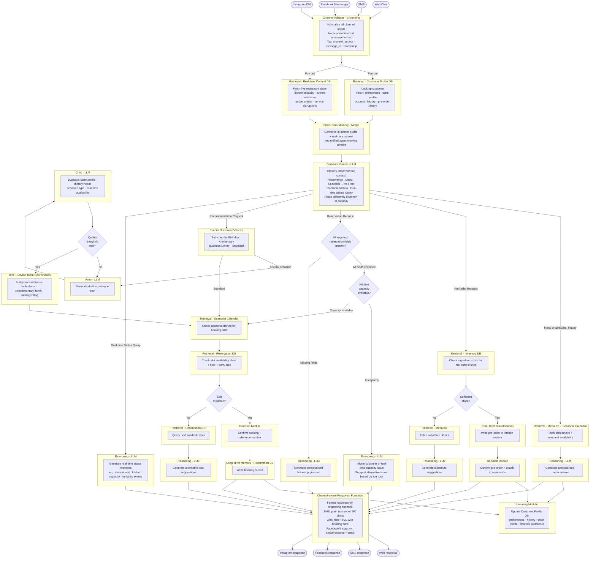

# The One Where Everything Happens At Once


Last time on Obi the Explorer, [the agent got a critic](https://plurobi.com/blog/2026/10/05/the-one-with-the-critic/). One LLM wrote the recommendation, a second one judged it, and nothing went out until it passed. I closed by wondering how much of a good host is really just knowing what's going on in the room, and whether an agent can ever know that from the outside.

This week, we find out. This is the last iteration, so I'll land it properly.

If you've worked front-of-house, you'll know there's never just one door. The phone rings while an email comes in, someone's waiting at the desk, and there's a message sitting in the Instagram inbox from last night. Assuming your place is trendy like that.

Meanwhile, the kitchen is telling you it's slammed, and you're quoting wait times based on whatever you last heard (Yeah, it gets chaotic, but it's rewarding at the end of the day). So you will notice that in the same restaurant there are four different conversations, and the customer gets a different experience depending on which one they pick.

<!-- more -->

## The new requirement

Two things, for the final time. First, the chatbot should work across every channel the restaurant uses. The website, SMS, Facebook Messenger and Instagram DMs. Second, it should know what's happening in the restaurant right now. That includes the kitchen capacity, current wait times, special events, anything that changes the answer basically.

Up to now, every requirement has added a feature, but this iteration changes where the agent lives and operates.

## What it replaces

For multi-channel communication:

1. Staff monitor the phone, email, social media and booking sites
2. The host tries to keep answers consistent across all of them
3. Different staff often look after different channels
4. Someone manually keeps information in sync
5. Customers get a different experience depending on how they got in touch

For real-time conditions:

1. The host keeps checking in with the kitchen on capacity and timing
2. Quoted wait times get adjusted on the fly when it's busy
3. The manager updates staff when something unexpected happens
4. Special events change what's available
5. Everyone improvises when service gets disrupted

Same exercise as always. Checking in with the kitchen is retrieval, while updating staff is a tool call. But look at the first list again. Nothing on it is about what to say. It's all about where the conversation came from, and making sure the answer comes out the same regardless.

That's the main focus of this iteration.

## The thing that actually changed

For five weeks, the agent has done one thing after another. Read the message, look up the customer, route it, answer it. At every step, the bot waited politely for the one before it. In technical terms, each task was handled sequentially. This could take a while depending on how long the previous step needed to complete its task. Some of that waiting was necessary because you genuinely can't tell the kitchen to cook before you've checked the stock. But some of it could have been handled differently.

Take what the agent needs before it can route a message. It needs to know who the customer is and now, it needs to know what's happening in the restaurant. Those two lookups have nothing to do with each other. The customer's taste profile doesn't change the kitchen's capacity, and the kitchen's capacity doesn't change who the customer is. So why wait for one before starting the other?

Introducing **Parallel Delegation**, everyone. For the uninitiated, it's a pattern where you split work into independent pieces, run them in parallel, then bring the results back together before moving on. It's the host who, the moment a customer walks in, asks the maître d', "Do we know them?" and radios the kitchen, "How busy are we?" at the same time. Of course there's a little time lag in practice, but this can be triggered at the same time with code.

Obviously, this is where I insert what movie or show my study reminded me of. Today, that's Everything Everywhere All at Once. It follows a laundromat owner being audited by the IRS, who feels like a disappointment to her father, is at odds with her daughter, and whose husband wants a divorce. The fun bit is that there are more versions of reality than anyone can keep track of, and she jumps between them in almost every scene.

No spoilers (you know the drill by now), but the whole film is about one person trying to handle everything at the same time without everything around her falling apart. That's this iteration. Four channels, live conditions, and lookups happening side by side. The trick isn't doing everything at once; rather, it's knowing which things can happen at once, and which can't.

Back to being serious...

## What changed from iteration 5

| Component | Change |
|---|---|
| Channel Adapter | New: turns every channel's message into one standard internal format |
| Retrieval — Real-time Context | New: fetches kitchen capacity, wait times and active events |
| Parallel fetch | New: runs the customer lookup and the real-time lookup at the same time |
| Merge into short-term memory | New: waits for both lookups, then combines them |
| Semantic Router | Upgraded: now sees live conditions, and handles real-time status questions |
| Capacity check | New: stops the booking flow when the kitchen is full |
| Channel-aware Response Formatter | New: shapes every reply for the channel it's going back to |
| Everything else | Carried over untouched |

Six new components, and every path from the last five weeks still runs inside them, unchanged.

## The new front of the system

```
Channel Adapter
      ↓
  [Run at the same time]
  ↙              ↘
Customer        Real-time
lookup          conditions
  ↘              ↙
   [Wait for both, then merge]
        ↓
   Semantic Router
        ↓
  [Everything from iterations 1–5]
        ↓
   Response Formatter → back out the right door
```

That merge step is the important one. It can't fire until both lookups are finished. When steps depend on each other like that, and nothing ever loops back, you've got what's called a **DAG**, a Directed Acyclic Graph. Fancy name, but simply it means do what you can in parallel, wait where you have to, never go round in circles.



## Three decisions worth arguing about

### Why does the Channel Adapter sit before everything, even memory?

Because nothing else in the system can work until the message looks the same.

An Instagram DM full of emojis and a text that says "book 4ppl sat 8 pm" mean the same thing, but they look nothing alike. Every module downstream, from grounding to the router to the Critic, expects one clean, standard format. So the adapter's only job is to take whatever came through whichever door and turn it into that format.

Think of it as the front door of the restaurant. However you arrived, by car, by bus, or on foot, everyone gets greeted the same way once they're inside. The adapter also tags the message's source, so the reply knows which door to leave by.

### Why does the parallel lookup happen before the router?

You may recognise this argument. Back in iteration 3, I said anything that changes how a decision should be made has to be loaded before that decision is made. I also said I'd be writing some version of that sentence in every remaining post. Here it is, for the last time.

The router now needs two kinds of context. Who the customer is, and how busy the restaurant is. If the kitchen is at capacity, a booking request for 8 pm tonight shouldn't be considered or enter into the full booking flow at all. The agent should go straight to providing alternatives. The router can only make that call if both lookups have finished.

This ties back to what I mentioned in iteration 4: the stock check and the kitchen notification had to happen in order, because one depended on the other. These two lookups don't depend on each other at all. The order of your steps should come from their dependencies, not your habits. Sequential by default is a choice; it is not compulsory.

The capacity check, by the way, sits inside the booking path rather than inside the router. The router's job is working out what you want. Whether the kitchen can handle it is a separate decision, and keeping it in its own box means the restaurant can tune that threshold without touching the routing.

### Why does every path end at one formatter?

The same booking confirmation needs to look completely different depending on where it's going. Plain text under 160 characters for SMS. A proper booking card on the website. Something chattier, maybe with an emoji, on Instagram. It's about delivering the same human and natural experience without having a response that feels robotic every time.

I could have made every path format its own replies. This includes the menu answer, follow-up questions, alternatives, substitutes, and capacity messages—each one tailored to four different channels. If we add WhatsApp next year, it would require editing a dozen different boxes.

Instead, every path sends its answer to a single place, and only that place knows anything about channels and how messages should be formatted. For the uninitiated, software engineers call this the **Facade pattern**: one simple front that hides the messiness behind it. This way, adding WhatsApp means changing one box or node.

At least, that's how I have chosen to design this.

## So, can an agent know what's going on in the room?

I owe you an answer from last week. The honest answer is partly.

It knows whatever the restaurant writes down. How busy the kitchen is, how long the wait is, whether there's a private party tonight. Put that information somewhere the agent can check, and it'll stop recommending a quiet anniversary dinner on the busiest night of the year.

What it can't know is anything nobody writes down. The table that was meant to leave twenty minutes ago and just ordered another bottle. The new starter who's struggling. The moment a busy service is about to turn chaotic. A good host notices all of that just by being on the floor. The agent only knows what the restaurant records, so it can only ever be as aware as the restaurant's data allows.

Of course, you could install cameras and sensors that try to read how people are feeling. But I think the whole place would feel empty and impersonal. I love new technology, but I like seeing different people too.

In the end, context is king, and the best scenario is not an agent replacing a host. Instead, it is an agent that handles all the tedious parts, like communication and context gathering, while everyone else is allowed to focus on the humans. The parts machines can't do.

## The capability, all of it

Six iterations in:
- **Iteration 1:** The agent executes a task
- **Iteration 2:** The agent routes between tasks
- **Iteration 3:** The agent remembers across tasks
- **Iteration 4:** The agent acts outside itself
- **Iteration 5:** The agent checks its own work
- **Iteration 6:** The agent works everywhere, aware of the room

Four channels, six intents, six data sources, two teams it can instruct, live conditions, a critic, and a memory that improves over time.

## What six iterations taught me

Back in the first post, I counted the boxes and found the LLM only did two of the seven jobs. Now that the design is finished, I counted again. In the final design, there are over thirty boxes, and only about a third of them involve an LLM. The rest are lookups, decisions, writes and formatting. Turns out AI agents still aren't mostly AI. It's about passing data and context throughout a system so that when AI needs to make a decision or perform an action, it can do its best.

The bigger surprise was this. The agent stayed on rails the entire time. Every path was predefined. It never once planned its own steps or decided to do something nobody had designed, and it still ended up handling everything a real front-of-house team handles.

There's a lot of noise right now about fully autonomous agents. Some problems need them, but I've just watched a system go from taking one booking to running every channel a restaurant has, and it never needed to make up its own plan. It needed good questions, a clear look at how the humans already did the job, and a lot of patience about the order of things.

So, I'll leave the series on the question I keep coming back to. How many of the agents being built right now actually need autonomy, and how many need a better diagram?

I hope to find an answer by designing and building more systems. Of course, I'll write about these as well, and that's mostly what I'll post on Thursdays.

If you're building agents and trying to figure it out, I'd genuinely like to hear about it.

--8<-- "cta-book-call.md"
