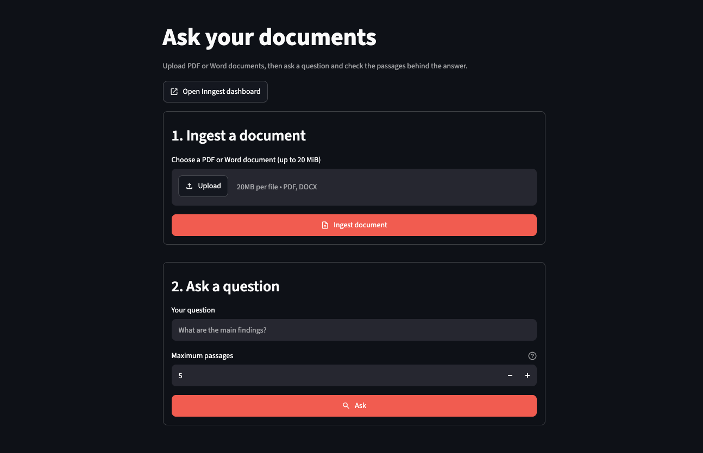
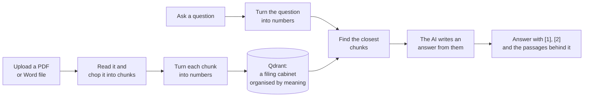
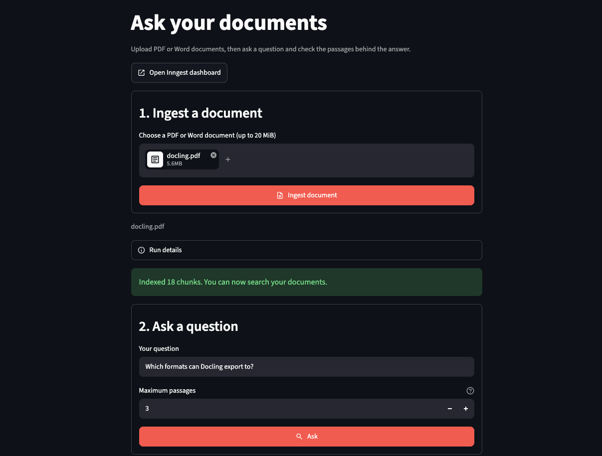
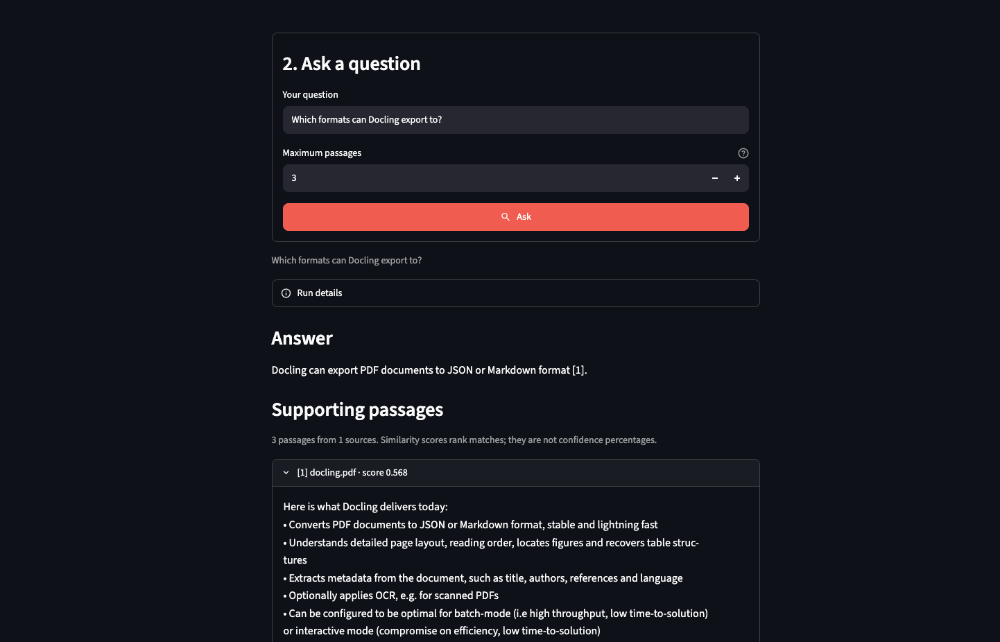

# The One Where the Documents Answer Back

On the last Friday of every month, my team gets together (remotely) for a hack day. We have complete freedom to build anything we are interested in. The only catch is that you should have a vision of how what you build will improve the company. The goal is to build a proof of concept (**P.O.C.**) to show the rest of the team by the end of the day. Then, everyone votes on which P.O.C. impressed them, and the winner gets £50 to donate to charity or claim as a voucher at any store.

I've been interested in the idea of a **company brain** since I first heard it in a Y Combinator video (YC is a well-known U.S. startup accelerator). It speaks to a problem I face every day as a data analyst: a lack of context. I build data pipelines and run analyses, but I rarely see the decisions that came before the work, so I rely on my manager to remember and pass them on. That doesn't scale, for him or for me. If meetings, emails and documents were saved somewhere an AI could search, it could hand me that context before I start the next task.

My conceptualisation for this idea was a RAG pipeline (explained below). What I built was a small app where you uploaded a PDF or Word document, asked a question in plain English, and it answered with numbered references, like [1] and [2]. Click a number to see the exact passage it used.

This post has two halves: what I built for the team, and what it would take to make it something a team can rely on. The second half is really where things get interesting.

<!-- more -->

## The problem

Chatbots are good at general knowledge and not great at **your** stuff. If you ask one about your contract, your staff handbook or a 40-page report, it either says it doesn't know or makes something up that sounds right, which is called **hallucination**. The second is the dangerous one, because nothing warns you the answer is wrong. That's why AI tools come with constant fine print telling you to check their answers.

You could paste the whole document into the chat, which works for a 2-page document but fails for a 400-page report. You could train a model on your documents, which is slow, expensive and overkill for "what does clause 7 say?" The third option is the one I built: **look up the relevant passages first, and give only those to the model.**

That's called **RAG**, short for **retrieval-augmented generation** (the term comes from a 2020 paper by Patrick Lewis and colleagues). Think of a closed-book exam against an open-book one. A chatbot on its own answers from memory, and bluffs when the memory is unsure. With RAG, it first flips to the relevant pages, then answers and tells you which pages it used. Most of the skill in an open-book exam is knowing where to look, and that's most of this build.

## What I built for the team

The app does two jobs: learn a document, and answer a question.

*The top row is "teaching the app a document". The bottom row is "asking it something".*

Here's what each box does.

**Teaching the app a document**

1. **Read it.** The app pulls the text out of the file page by page, so it always knows which page a passage came from. That's what makes page references possible later.
2. **Chop it into chunks.** You want the app to find the right paragraph, not return a whole lot of irrelevant data. So the text is cut into **chunks** of about 1,000 **tokens** each (a token is a short word or part of a longer one), roughly a few paragraphs. Each chunk overlaps the last by 200 tokens, so a sentence on the edge isn't cut in half and lost.
3. **Turn each chunk into numbers.** An OpenAI **embedding** model reads a chunk and returns a list of 3,072 numbers that captures its meaning. Similar meanings get similar numbers, even when there are no shared words: "cheap flights" lands near "affordable airfare" and far from "tax return". Think of GPS coordinates for ideas.
4. **File them in Qdrant.** Each chunk is stored with its numbers, text, filename, and page. **Qdrant** is a database built to find things by closeness rather than by exact match. This type of database is also known as a **vector database**.

**Asking a question**

1. **Turn the question into numbers.** It goes through the same embedding model, which matters: comparing numbers from two different models is like comparing coordinates from two different maps.
2. **Find the closest chunks.** Qdrant returns the chunks whose numbers are closest to the question's. This is the "flip to the right pages" step. It matches on meaning, not keywords, so "can I get a refund?" can find a paragraph about "reimbursement".
3. **Write the answer from those chunks only.** The passages go to a language model with strict instructions: answer only from them, treat them as data rather than orders, say so if they don't answer the question, and mark each claim with its passage number. Those numbers become the [1] and [2] you can click to verify.

A few other tools do the supporting work. **Streamlit** helps build interactive data apps; **FastAPI** is the back end behind them, the part that works out of sight; and **Inngest** runs each stage above as a saved step, retrying only the step that failed, so I don't pay OpenAI twice for the same work. Everything runs on a laptop. The only outside service is OpenAI, so you need your own API key.

### A decision worth arguing about

**Make the AI cite its sources, then check.** Asking is a request, but checking is what counts. After the answer comes back, my code looks at every [number]. If the model cites a passage it wasn't given, say [7] when it received three, the answer is rejected rather than shown. That proves the references point somewhere, not that the answer is right, which is why the passages sit right underneath. The point isn't to trust the answer. It's to make it quick to check.

## Does it work?

I tried it on a public sample, the *Docling Technical Report* (a nine-page paper on arXiv, under a Creative Commons licence). The app split it into 18 chunks. I asked: **"Which formats can Docling export to?"**

It said JSON or Markdown, with a [1] beside the claim. Passage [1] came from page 2 of the paper (the page number sits at the end of the passage) and contains the sentence about converting PDFs to those formats. The reference checks out.

That's one question on one document. It shows the RAG pipeline works from upload to cited answer, not that the answers are good in general.

Two things went wrong along the way, and both taught me something.

**Search results lost track of their sources.** At first I kept the passage text in one list and the file names in another. When several passages came from the same file, the two lists stopped lining up. The fix was to keep each result together as a single package: the text, the file, and the page. Things that belong together shouldn't be stored apart.

**The UI removed the passages.** Streamlit keeps running while you edit code, so my open app was still using an old layout for the answer data. A newer answer arrived with passages that the old layout had no room for. They were dropped without warning, and the screen showed an error. I reproduced it in a test first, then fixed it.

Both fixes are now covered by tests. There are 44 in all, and none of them touches OpenAI.

## From demo to production

A hack-day demo assumes a lot: that only I am using it, that my laptop stays on, that nobody is watching the bill, and that if it breaks I'll restart it. In production, these would make a terrible product. I started building the production version in a separate branch, packaged as a few **Docker** containers (think shipping containers: they run the same anywhere) on one server. Here's the gap, with an honest status for each line:

| In the demo | In production | Status |
|---|---|---|
| Anyone who can reach my laptop can use it | **Sign-in** through the company login (oauth2-proxy, a doorman that sends anyone not signed in to the login page), limited to approved email domains | Built; real sign-in not tested |
| Plain `http://` | **HTTPS**, certificates renewed automatically (Caddy, the front door that handles HTTPS for you) | Built; certificate issuance not tested |
| Qdrant saves to a folder | A **Qdrant server**, protected by a key | Built; tested on a laptop |
| Inngest's dev server, no login | **Self-hosted Inngest** with signing keys (secret codes that prove a message came from the right place), its own database, and a dashboard kept off the internet | Built; tested on a laptop |
| A missing setting fails halfway through a paid job | The app **refuses to start** and names the missing setting | Built, with tests |
| No backups | A **backup script** | Built; only the Qdrant restore rehearsed |
| No monitoring | Logs and health checks only | Not built |

I'll be blunt about that last column. I've run all of this **on a laptop**. Every service became healthy; a real PDF was ingested and answered questions; requests without a sign-in were turned away; and a backup of the Qdrant index was restored with all 18 chunks. I have **not** run it on a real server, with a real domain, a real company login or real users. Until I do, it's a plan that passes its tests, not a production system.

### The big question: who sees what?

This decision shapes everything else, and the options are different products.

**Option one: one team, one shared pool.** Everyone who signs in sees everything that's been uploaded. It's the simplest to build, and it's what I've built. For a team knowledge base (the handbook, the policies, last year's reports), it's often exactly right. The catch is that everyone sees everything, so it would be wise not to upload any document you don't want the whole team to have access to. The project's deployment notes (a file in the repository) say so in plain words.

**Option two: multi-tenant.** A **tenant** is one customer or team whose data must never mix with anyone else's. Think of a hotel: one building, one kitchen, a locked room for every guest. I haven't built this, so here is where I'd start, not a description of working code:

1. **Stamp every chunk** with a tenant ID and determine the asker's tenant from their login.
2. **Filter every search** by that ID, enforced in one place in the code, so it can't be forgotten or skipped. Qdrant's own advice is to use a single collection with a tenant field on every point, rather than a collection per tenant.
3. **Separate uploads and backups** per tenant, so one can be restored without touching the others.
4. **Add deletion.** Today there is none, and a real customer will ask.
5. **Limit and meter each tenant** so that a single huge upload doesn't make everyone wait and the OpenAI bill can be split fairly.

The first test I'd write: **sign in as tenant A, ask about tenant B's documents, and check that nothing comes back.** If that ever fails, nothing else on the list matters.

### What else production-worthy means

- **Measure the answers.** One question on one document isn't evidence. From my [invoice review post](https://plurobi.com/blog/2026/10/16/the-one-where-the-supplier-fixes-their-own-invoice/), I'd borrow the **answer key**: questions with known answers; rerun after every change. In other words, **evaluation**.
- **Teach it to say "I don't know".** Search always returns the nearest chunks, even when none is close. A score threshold would let the app admit it has nothing relevant.

My order: run it on a real server and rehearse a restore; decide with the team which option to go with; build the answer key; add deletion and the "I don't know" threshold. Scale comes last.

## Try it yourself

The code is public: [github.com/noelogbuagu/RAG-pipeline](https://github.com/noelogbuagu/RAG-pipeline), with a sample PDF so you can try it straight away. You need an OpenAI API key. Requests cost a small amount, and your documents are sent to OpenAI, so use files you're allowed to share.

## Backstage

In the *Black Mirror* episode "The Entire History of You", everyone has an implant that records everything they see and hear, so any moment can be replayed on demand. A memory can always be checked against the record. That's the idea behind the numbered references. The answer is a claim, and [1] is the replay.

The episode is also a warning. Having the record doesn't tell you what it means, and whoever watches the replay can still read it incorrectly because it's open to interpretation. It's the same here. A citation shows where an answer came from, not that the answer is right, so someone still has to check.

If your team could ask one shared pile of documents a question, would you want everyone to see the same pile?

--8<-- "cta-book-call.md"
