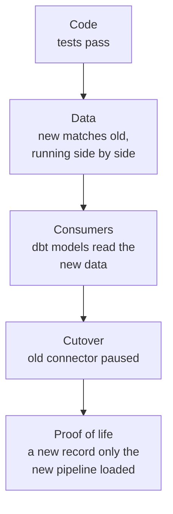

# The One Where the Row Counts Matched

Last week on Obi the Explorer, I told you why pausing a Fivetran connector doesn't put any money back in your pocket, and what you inherit when you own the pipeline yourself. If you missed it, you can [catch up here](https://plurobi.com/blog/2026/10/27/the-one-where-you-leave-a-managed-connector/). Today's question comes before all of that: how do you know the replacement actually works?

I'll save you some time. Matching row counts won't be enough.

<!-- more -->

## The ask

Every migration has a moment where somebody asks, "Is it done?"

For me, it was my manager, and it came while I was deep in Zendesk, which was taking a very long time. He wanted to know whether Braze was done, and what I still had left to do. I'd been validating it for a good while. The pipelines were green, the counts matched, and, as far as I could tell, only the cutover remained.

Then I went back through everything Braze makes available and found I'd only brought across 5 of the 19 tables. Everything I had compared matched perfectly. I just hadn't compared everything. So I went back and made sure it was all there.

Green runs and matching counts sound like plenty of proof. They turned out to be very few, and the rest of this post is about why.

## Why matching counts prove so little

My first version of each pipeline copied the data Fivetran had already loaded into Snowflake, then compared the result. That was a sensible place to start. I was replacing the ingestion step, so copying Fivetran's data let me first test everything after ingestion. It showed that the scheduling, deployment, logins and SQL all worked.

It didn't prove that I could get the data myself. If Fivetran stopped, my copy would have gone stale at the same moment. And two copies of the same old data match perfectly, so the counts told me almost nothing.

Think of a photocopier. A perfect copy tells you the machine works, and nothing at all about whether you can write the document yourself.

## The order I switch things in

A migration has three finish lines. The pipeline works. The dashboards read it. The old path has stopped safely. Here's the order I used for each connector, and what each step is really checking:

1. **Run the new pipeline beside the old connector.** Start from a list of everything the source provides, not from the tables you've built so far. Each pipeline writes to its own place in Snowflake, so nothing collides. Then I compare them: counts, keys, and the differences I expect between two different tools. It's the equivalent of cooking the new recipe next to the old one and tasting both. This proves the logic and the shape of the data. Independence comes later.
2. **Point dbt at the new data.** dbt is the tool that turns raw tables into the models our dashboards read. I move it first, while the old connector is still running as a safety net. If something is wrong, I find out while I can still compare against Fivetran.
3. **Pause the old connector.** Only now, and only paused, never deleted. Its data remains a frozen reference, and if I ever unpause it, it resumes from where it left off.
4. **Find a record only the new pipeline could have loaded.** This is the real proof, and I'll call it **proof of life**. After the pause, new data continues to arrive in the pipeline. It never shows up in the frozen Fivetran copy, because that copy stopped changing the day the connector paused.

For Braze, which went first, I checked every event table after the pause. Each one had received more than 100,000 new rows that the old connector couldn't have loaded, and the six-hourly runs hadn't missed a beat.

## The one where everything passed

Step 2 is where I learned the most. Here's the version of events that should worry you.

I'd changed our dbt source definitions to point at the new data. The counts looked similar, freshness checks passed, and everything was green.

But one of the dbt packages we had installed (a **package** is a bundle of ready-made models written by someone else) came with its own settings for where raw data lives. Those settings were separate from ours, and they were still pointing at the old source. The freshness checks were looking at the new data, but the package's models were still reading the old database. The two datasets closely matched, so my tests had nothing to complain about.

The old tables contain real data, so a model that reads them still returns plausible results. Nothing looks broken.

I found it during the checks after merging the source change. I traced a downstream model's dependencies through dbt's **manifest**, the file dbt generates that records every model and source and how they connect. It showed that an installed package was still pointing at the old database.

The fix was three small things. I corrected the package's settings, rebuilt a representative set of models, and checked what dbt had actually resolved: the **compiled lineage** in that manifest, the real map of what reads from where. A representative set is strong evidence, short of a guarantee.

Editing the config tells dbt where to read from. The compiled lineage shows where it actually reads from. Those can disagree, and it's important to check.

*Each rung proves something the one below can't.*

As tradition dictates, I'll talk about the movie or show this part of the project reminded me of. Today, that's **Inception**.

The film follows a team who enter people's dreams. The dreams look so real that you can't tell where you are just by looking around. So each character carries a **totem**, a small personal object (Cobb's is a spinning top) whose weight and balance only its owner knows. It's a check that nobody else's dream can fake.

Leaving Fivetran involved considerably fewer dramatic action sequences, but a surprisingly similar problem. The old and new data were supposed to look alike, and they did. So I needed a check the old data couldn't fake.

Mine was a genuinely new record: an event that happened after the old connector stopped. If it showed up in the new pipeline's tables and not in the frozen old copy, the new pipeline was doing the work. That's the proof of life from step 4.

Familiar results weren't enough. I needed something that could tell the two apart.

Back to being serious...

## What changed

| Weak proof | Stronger proof |
|---|---|
| The counts match | New data reaches the dashboards without the old connector |
| Every table I built matches | Every table the source provides is accounted for |
| The workflow turns green | The required work finished, and separate checks cover whether the data is right |
| The config edit looks right | dbt's resolved dependencies point at the intended source |
| The fix handled the example that broke | Later examples refined the rule and became tests |

Same pipelines, same dashboards. A higher bar for what I'm willing to call "done".

## Three decisions worth arguing about

### Why not trust the counts?

Counts compare two things that can share the same mistake. A copy of the same old data, or a model still reading the old source, will match every time. Counts also only cover the tables you chose to count. Mine covered 5 of the 19 Braze tables, and every one of those matched.

The trade-off is real. Proof of life exists only after the pause, the point at which going back becomes complicated. So everything before that point has to be as proven as I can make it.

### Why switch off checks that used to pass?

After the pause, Fivetran's data froze. My comparison checks kept comparing against it, so they kept flagging the same historical gap every day. A stopped clock is right twice a day, and checking against it tells you the same time forever. So I retired them and kept the checks that monitor the live pipeline: whether the keys are clean and whether ingestion is still progressing.

### Can I roll back?

Yes, but it takes more than reverting the code, because reverting the code isn't the same as restoring the data. If I unpaused the old connector, it would pick up where it left off and write to its own old tables, while the dashboards would keep reading the new ones. Nothing would move back on its own.

Going back means changing three things together: the old connector, the new pipeline, and what dbt and the dashboards read. That's why the connectors are paused and retained rather than deleted. The way back stays open.

## What this proves

Here's what I'm confident in, and how far each claim goes.

- **The new pipelines run without Fivetran.** After the pause, they kept loading records the old connectors could not have loaded. That's the proof of life.
- **The dashboards read the new data.** I checked what dbt actually resolved, not what the config said, and rebuilt a representative set of models against the new source.
- **Retries are safe.** The loads are idempotent, meaning running them twice yields the same result as running them once. That's a smaller promise than "zero data loss", and it's the one I can prove.
- **Other people can run this without me.** I wrote the runbooks for someone who didn't build the pipelines, and the rest of the team uses them. They're written step by step, so even a newcomer could follow them (with ample help from an AI agent, of course).

Next time, I'll explain how a pipeline remembers where it stopped, using a ledger, a bookmark and a watermark.

What's the one check you'd trust to prove your migration really worked?

--8<-- "cta-book-call.md"
