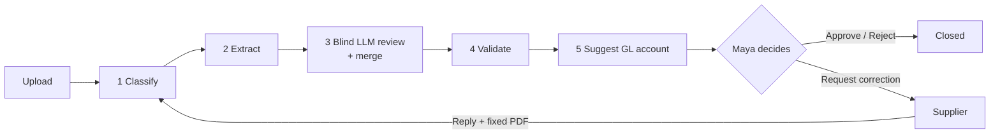
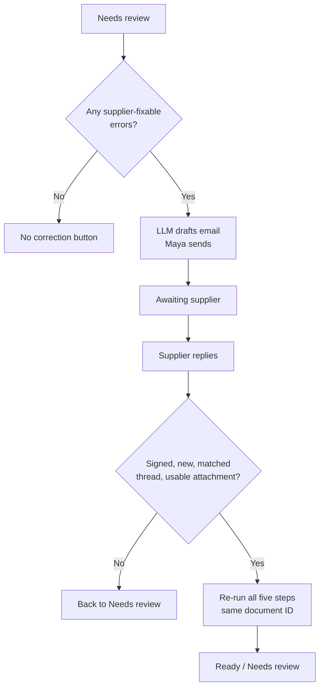

# The One Where The Supplier Fixes Their Own Invoice

Recently, I've been building an end-to-end invoice review app. Not the most glamorous sentence I've ever written, I know. Stick with me, because it turned into one of the more interesting lessons I've had about where AI belongs in a system and, more importantly, where it doesn't.

<!-- more -->

My [cognitive architecture series](https://plurobi.com/blog/2026/09/03/turns-out-ai-agents-arent-mostly-ai/) explored this in greater depth over multiple iterations, making it more complex each time. Dave Ebbelaar's tutorial inspired this build, but I added a couple of wrinkles to make it truly mine. You can watch his video below to try it as well, but let me know how you made it your own.

<iframe src="https://www.youtube-nocookie.com/embed/YYeZh6Hac9E" title="Build a Document Review App in 3 Hours (Python, React, Azure) by Dave Ebbelaar" style="position: absolute; top: 0; left: 0; width: 100%; height: 100%; border: 0;" allow="accelerometer; autoplay; clipboard-write; encrypted-media; gyroscope; picture-in-picture; web-share" allowfullscreen></iframe>

Every business that buys anything gets invoices. Somebody has to read each one, check it, and decide where the money goes. Simple enough for one. Now multiply it by a few hundred a month, in several languages.

This personally happened to me when I got my older sister a travel bag from Oliver Bonas for her birthday. The one I got had no strap. I thought that was how it was meant to be. Until my sister told me otherwise. I reached out to the store, sent the receipt, and I'm still waiting for that strap. Could I have gone in personally? Maybe. But I live quite far from her, and why can't they send it faster? It's the principle!

In this post, I'll walk through the whole pipeline, from upload to approval, and then spend a bit longer on my favourite part: what happens when the supplier gets it wrong. This was the biggest change I made to the tutorial.

## Problem statement

Meet Maya. She works in finance at Plurobi B.V., a (fictional, I promise) Dutch company that buys cleaning, maintenance and electrical services from suppliers across the EU. Her inbox is a steady stream of supplier invoices and expense receipts. Clean PDFs, wonky scans, phone photos of crumpled fuel receipts, in English, Dutch, German and French.

Before any of it reaches the books, Maya has to answer four questions:

- **What is it?** An invoice or a receipt?
- **Are the values right?** Supplier, VAT number, dates, totals.
- **Does it follow policy?** Valid EU VAT, totals that add up, no duplicates.
- **Where does it go?** Which **GL account**? For the uninitiated, a general ledger account is the bucket in the books an expense gets filed under: cleaning, fuel, repairs, and so on.

The tempting move is to hand the whole document to a model and ask it all four. It'll even do a decent job most of the time. But "most of the time" isn't good enough in this scenario.

Ask a model to read an invoice, and it will give you a total. Ask it for a VAT number, and it will give you one. Whether that number is actually on the page is a separate question. AI models are definitely getting better, and they make things up less often than they used to. However, it is not zero yet. What's dangerous, though, is that there's no error or warning to let you know. If you've read anything else I've written, you'll know this is my least favourite kind of failure—the quiet one.

And when the supplier genuinely made the mistake, the job isn't even over. You will have to reach out to them to let them know what is wrong, wait for their reply and then review it all over again. That's a lot of wasted time and energy. By then, the invoice lives in three inboxes, and nobody's sure which version is the real one. This situation is obviously less than ideal.

## The thing that actually changed

The question I ended up asking wasn't "how do I get the model to read invoices better?" It was "what should the model be *allowed* to decide?"

And the answer, it turns out, is not much.

Obviously, this is where I insert what movie or show this project reminded me of. Today, that's Catch Me If You Can. Frank Abagnale (Leonardo DiCaprio) cashes millions in cheques that look completely legit. Everything from the type of paper, the signature and his confidence in carrying out the fraud is top tier.

As you can imagine, nobody checks, because nothing obvious looks wrong. The man who eventually catches him, Carl Hanratty (Tom Hanks), an FBI agent, isn't smarter. He checks the boring details everyone else skipped. What's wild is that it's supposedly a true story about a teenager, though much of it has since been disputed.

An LLM reading an invoice has a bit of Frank in it. It's fast and confident, and if a VAT number is missing, it might hand you one that looks right anyway. It isn't trying to fool you. It's built to give plausible answers, and plausible isn't the same as true.

So I built Hanratty.

Back to being serious...

## Approach overview

Three rules, and everything else hangs off them:

1. **Hybrid review:** There are two readers, but one is more important than the other. Azure Document Intelligence reads the document first. An LLM reads it separately and is only allowed to fill gaps.
2. **Deterministic rules:** The rules are plain Python. VAT checks, totals and duplicate detection never go anywhere near a model.
3. **Human-in-the-loop:** A person makes every call. Approve, reject or request a correction. The system prepares the case but never makes the final decision.

Or the short version: **AI gathers the evidence, code owns the rules, Maya decides.**

The stack is FastAPI, Pydantic, SQLite, Azure Document Intelligence, Azure OpenAI, Nylas for email, and a React front end, all running as a single Azure Container App. (Not sponsored by any of them. Wink wink.)

## Step-by-step process

### Step 1: Work out what you're holding

**Document Intelligence** is Microsoft's prebuilt document reader. It has one model trained on invoices and another trained on receipts. What it doesn't come with is a ready-made way to tell which one you're looking at. A bit of an oversight, if you ask me. Or an upsell so you use a classifier they built as well?

So the first call goes to the LLM with the **original file** and a strict output shape: `invoice` or `receipt`, a confidence score and one sentence explaining why. That single word is a switch. It decides which extractor runs, which rules apply and which fields Maya ends up seeing.

### Step 2: Let the specialist go first

Document Intelligence runs `prebuilt-invoice` or `prebuilt-receipt`, and its output is mapped straight into my own Pydantic models. **Azure's field names stop at the adapter.** The rest of the app never sees `VendorTaxId`. It sees `vendor_vat_id`. I did this because there could be a day when the extractor would need to be replaced for one reason or another. If that happens, one file needs to be changed.

### Step 3: Get a second opinion that hasn't seen the first

Then the LLM reads the same file again, oblivious to the first check. It deliberately **never sees** what Document Intelligence found. Think of two witnesses giving statements in separate rooms. If their stories match, great. If they don't, you want to know. I've watched too many crime shows not to add that analogy, sorry!

Once both have read it, a short piece of plain code goes through the fields one by one and decides which answer to keep. The rules are deliberately simple:

- If Document Intelligence found a value, **it wins**. Full stop.
- If it found nothing, the LLM's value can fill the gap, but only if it parses into the right type. This could be a real date or amount.
- Every field is tagged with its source, and the two readings sit side by side so Maya can see exactly where they disagree.

This is the most important rule in the whole build. On two Dutch invoices in the test set, Document Intelligence skipped the purchase order line, and the LLM picked it up both times. This is the correct behaviour. In others, the errors were deliberately put there, and **the LLM is not allowed to repair them.** If it could, it would quietly turn a real problem into a clean-looking invoice just like Frank. We don't want that, especially when dealing with financial transactions.

### Step 4: Make the rules boring

Validation is a pure Python function. There's no AI or vibes. It checks the VAT format and checksum with `python-stdnum`, ensures the totals add up to within **€0.01**, verifies the due date isn't before the invoice date, confirms the customer's VAT is actually ours, and asks SQLite whether we've already seen this supplier and invoice number.

Each problem it finds is either an **error** or a **warning**. Errors stop Maya from approving the invoice until they're sorted. Warnings flag something worth a look. A missing purchase order, for example, is a warning, because plenty of legitimate invoices don't have one. A missing supplier VAT number is an error, and it's exactly the kind the supplier has to fix.

Is any of this exciting? Not really. But it gives the same answer every single time, and when money is involved, that matters far more than cleverness.

### Step 5: Suggest, don't post

Finally, the LLM suggests a GL account. It only sees the cleaned-up fields, never the PDF, and it has to pick from a fixed list of ten. If it invents an account code, the code can't be saved. The suggestion becomes Maya's default, and she can change it with one click. The model helps speed up the process, but Maya gets the final say.

## The supplier loop (my bit)

I loved working on this project and wanted to add something unique to make it more valuable. The most annoying part is having to follow up with the supplier for corrections, then wait, make the corrections, and update your records. I didn't want the review to end there. "Rejected. Please get in touch with the supplier." Good luck, Maya.

The fix started after I realised that **"Request correction" is not the same as "Reject".** Reject closes the case. Requesting a correction keeps it open while someone else does their part. Treat them as the same button, and you lose the thread. Literally, since it's an email thread. So sending a correction moves the review to its own status: **Awaiting supplier**.

Here's how it runs:

1. **Only fixable problems count.** A filter strips out warnings and anything only we can fix, like a duplicate invoice or low extraction confidence. If nothing is fixable, the button doesn't even show up.
2. **The LLM drafts; Maya sends.** The draft covers only those issues. Maya adds the address and sends it from her own mailbox via **Nylas**, an email API that lets an app send and read email as a real person would. The message and thread IDs get stored against the document, along with an attempt number.
3. **The reply rings the doorbell.** A **webhook** is a URL another service calls when something happens. Instead of checking the inbox every five minutes, the inbox rings you. When the supplier replies, Nylas calls my `/events` endpoint, and before anything touches the pipeline, that endpoint:
   - Checks the **HMAC-SHA256 signature**, a stamp proving the call really came from Nylas: wrong stamp produces a 401.
   - Ignores anything that isn't a new message in the inbox
   - Ignores messages it has already handled, so a repeat delivery does nothing. That's **idempotency**, a word I promise is less scary than it looks.
   - Matches the reply to a correction by its **thread ID**
   - Grabs the first PDF, PNG or JPEG attachment under 4 MB
4. **Same pipeline, same document.** The attachment downloads in the background and goes through all five steps again, under the **same document ID**.
5. **Back to Maya.** The review lands on Ready or Needs review. Still wrong? She sends attempt two in the same email thread, and the whole conversation stays in one place.

## Three decisions worth arguing about

### Why not let the AI decide what to ask the supplier for?

The easy option is to give the model the whole review and ask it to email the supplier about everything wrong. The trouble is, not everything wrong is the supplier's fault.

Say we've seen this invoice number before. That's a duplicate in *our* records, not a mistake on their invoice. Or say the scan was hard to read. That's *our* tool struggling, not theirs. Emailing the supplier about either would be like sending your plate back because you're full.

So code decides which problems go in the email before the model writes a word. The model's only job is to turn them into a clear, polite message. Which, to be fair, it's very good at.

### Why does the corrected PDF go through the whole pipeline again?

You could argue that once the supplier sends a fix, you only need to check the wrong field. This is faster and cheaper.

But a supplier who has fixed their VAT number has also sent you a brand-new document, and it could contain new totals, dates, or even a new invoice number. It's better to review the entire document again. Hanratty would. Just imagine me channelling him.

So it runs through all five steps, under the **same document ID**. One small detail made that work: the duplicate check skips the document's own ID. Otherwise, the corrected invoice would flag itself as a duplicate, which is technically true but completely unhelpful.

### Why does every failure land back with a human?

A reply with no usable attachment, a download that falls over, a webhook payload that doesn't make sense. All of them put the document back in **Needs review**. None of them nudges it towards approved.

It's the same instinct as the merge rule earlier. When the system isn't sure, it says so, and a person picks it up. **Fail back to a human, never forward.**

One honest caveat here. The handoff to the background uses FastAPI's `BackgroundTasks`, which handles normal delays but not a restart mid-task. For a single-instance build, that's acceptable. In production, it becomes a proper queue, and I left a note in the code to that effect.

That's how I've designed this since it is a demo/POC.

## Putting it somewhere real

There was one catch with the supplier loop. For Nylas to tell my app a reply had arrived, it needs an address it can actually reach. `localhost` only exists on my laptop, so the whole app had to be hosted on a public URL. And, as always, a few things only showed up once it was real.

- **Ghost webhooks.** To test locally, I used [Pinggy](https://pinggy.io/), which gives your laptop a temporary public URL. Great tool, but I was on the free version, where the URL dies after an hour. The webhook pointing at it doesn't. Nylas keeps calling every webhook you've registered, dead ones included, until you go and delete them yourself.
- **`localhost` and `127.0.0.1` aren't the same thing.** They point at the same machine, but browsers treat them as different websites. For the uninitiated, **CORS** is the browser rule that decides which websites are allowed to talk to your API. Mine allowed one address while the page was open on the other. So the upload worked, and the API returned a clean `201`, but the browser refused to return the response and showed "Failed to fetch" instead.
- **SQLite on Azure Files means one copy of the app.** Azure Files doesn't respect SQLite's file locks, so only one copy of the app can safely write to the database at a time. Run a second, and you get `database is locked`.
- **Company names matter.** With the customer written as plain "Plurobi", Document Intelligence lost the supplier and customer details on four of the test documents. "Plurobi B.V." brought them all back. Turns out, the legal form helps it recognise a company name. Who'd have thought?

## Results

The easiest way to show what this changes is to follow a single invoice from start to finish.

The invoice arrived without the supplier's VAT number. The validation step flagged that as an error, so the review was marked **Needs review**, and Maya couldn't approve it. Because a missing VAT number is something only the supplier can fix, the app offered her the option to request a correction. The model drafted the email; Maya checked and sent it; and the review moved to **Awaiting supplier**.

The supplier then replied from Gmail with a corrected PDF attached. The app automatically picked up that reply, downloaded the new PDF, and ran it through all five steps again. This time, every check passed, and the same review moved to **Ready**, waiting for Maya to approve it. At no point did anyone have to download the attachment, forward the email or upload the new file by hand.

For whoever is doing the reviewing, that adds up to four practical differences:

- **They can see where every value came from.** Each field is labelled with its source, whether that was Document Intelligence, the LLM filling a gap, or a person correcting it by hand.
- **They know exactly why they can or can't approve something.** Errors block approval; warnings don't. The reason is shown right next to the approve button.
- **The supplier corrects their own mistake.** The corrected invoice is then checked against the same rules as the original, so nothing gets waved through just because it's a second attempt.
- **The whole exchange stays in one place.** The original invoice, the correction email, the supplier's reply and the fixed PDF all sit on one review, instead of being spread across several inboxes.

### The numbers

One invoice is a nice story, but it isn't evidence. So I also tested the pipeline against all 13 documents in the test set. Each test document comes with an answer key that records what the document actually says and which problems it should be flagged for. The evaluation runs every document through the pipeline and compares the output against that answer key.

I ran it twice. The first run used Document Intelligence on its own, without the LLM review. The second run added the LLM review and the merge step, which is how the app actually works.

On its own, Document Intelligence read **167 out of 169 fields correctly, which is 98.8%**. Both mistakes were the same field on two Dutch invoices that use a compact layout. On both, Document Intelligence missed the purchase order number. Because the purchase order appeared to be missing, each invoice received a "missing purchase order" warning it shouldn't have received.

Adding the LLM review fixed both of those mistakes. The LLM found the purchase order on each invoice, and the merge used it to fill the empty field. As a result, the first invoice came out without any issues. The second invoice was left with only the problem it was built to test: a missing supplier VAT number. There was one other disagreement regarding the fuel receipt, in which the two readers chose different expense categories. In that case, Document Intelligence's answer was retained as intended, and the receipt still passed.

| | Document Intelligence alone | With the LLM review |
|---|---|---|
| Fields extracted correctly | 167/169 (98.8%) | Not measured |
| Documents flagged correctly | 11/13 | 12/13 |
| Calls to Azure that failed | 0/13 | 0/13 |

A document counts as "flagged correctly" when it ends up with exactly the problems it was supposed to have, with nothing missing or extra. With the LLM review, 12 of the 13 documents got this right. The one that didn't is the duplicate invoice, and that's because of how the test works, not a fault in the app. The app can only spot a duplicate by comparing a new invoice with one it already has stored, and the test runs each document on its own with nothing stored. When I uploaded the original invoice and then the duplicate in the app itself, the duplicate was flagged as expected.

### What this doesn't prove yet

These results are encouraging, but they have clear limits.

- **The test set is small and made up.** Thirteen fictional documents can show that the design works as intended. They can't tell you how accurate it would be on hundreds of real invoices a month.
- **The figures come from a single run.** Results can shift slightly from run to run. Field accuracy, for example, can land on either 167 or 168 out of 169.
- **It runs as a single copy of the app.** That's fine for a demo, but a busy finance team would need something that can run multiple copies at once.
- **It only checks the format of VAT numbers.** It confirms a VAT number is shaped correctly, but it doesn't check the EU's official register to see whether that number actually belongs to a real, registered business.

Those are the next problems to solve, and I haven't solved them yet.

## Frank Ends Up at the FBI

I hate spoilers, but this film came out in 2002, so I'm calling it fair game. Surprise, surprise, the FBI catches Frank. Duh. He's a teenage fraudster on the run across the US, taking on the FBI on his own, so it was only ever going to end one way. What surprised me the first time I watched it was what happened next. Frank doesn't spend the rest of his life in a cell. He ends up working for Hanratty at the FBI, helping to catch cheque fraudsters, because nobody knows how to spot a convincing fake better than someone who used to make them.

That's the role the LLM plays in this build. It isn't kept out of the process, because it's genuinely useful. It reads each document blind and gives us a second opinion. It found the purchase orders that Document Intelligence missed. It also drafts the correction email that Maya would otherwise have to write from scratch. The difference is that everything it produces now goes through the checks rather than replacing them.

But there's one part of this I keep coming back to. Right now, the LLM writes the correction email, and Maya reads it and decides whether to send it. Only one click separates the model's draft from the supplier's inbox, and that click belongs to Maya. With thirteen test documents, she has time to read every word of every email. With three hundred real invoices a month, she probably won't. At some point, she'll start skimming. And once she's skimming, it's only a matter of time before someone asks why she's clicking send at all, and suggests letting the model send the emails itself.

Frank got a desk at the FBI, but nobody gave him the keys to the vault. I'm still determining where the line should sit for these emails. What I'm fairly sure of is that it shouldn't be decided by how tired Maya gets.

## Call to action

If you haven't seen Catch Me If You Can, the opening credits alone are worth it. Please, do better!

And if your finance or ops team is still chasing corrected documents through inboxes and spreadsheets, I'd genuinely like to hear how you're handling it.

--8<-- "cta-book-call.md"
