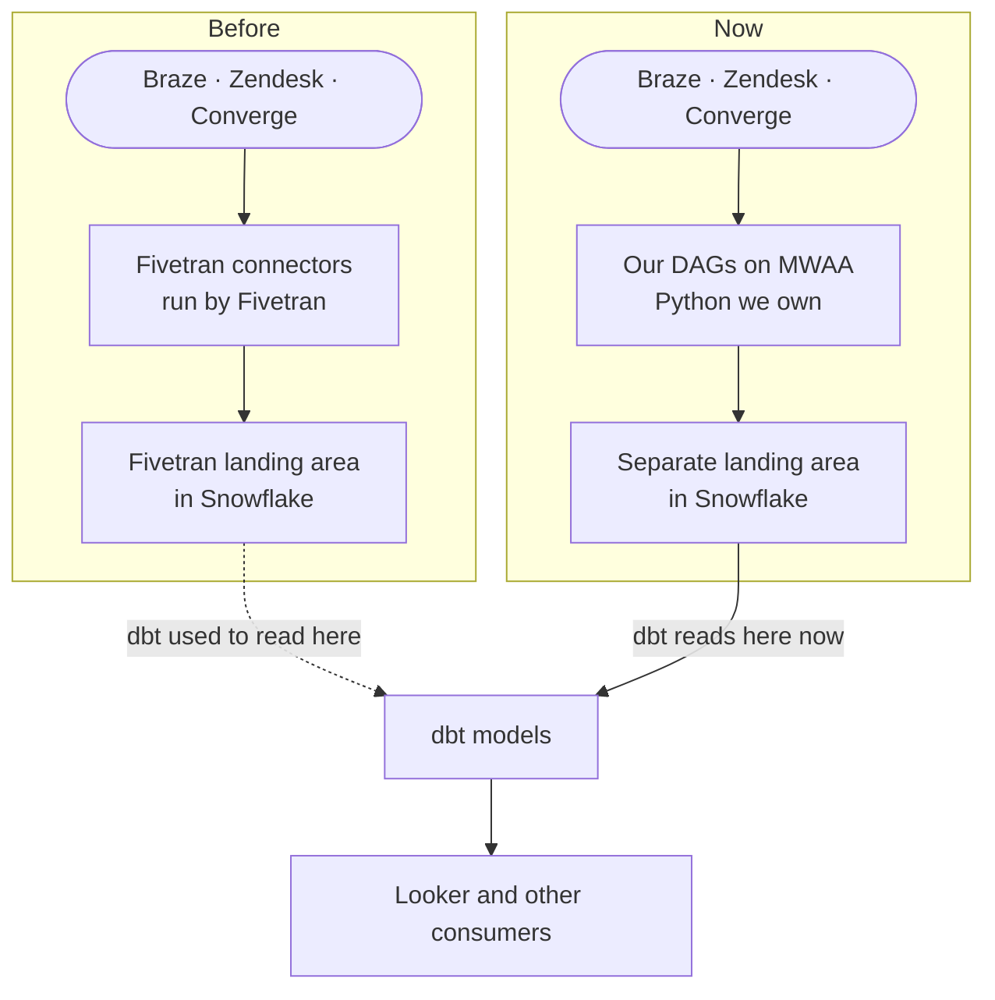

# The One Where We Replaced Fivetran

Last time on Obi the Explorer, [the agent learned to do everything at once](https://plurobi.com/blog/2026/10/14/the-one-where-everything-happens-at-once/). Four channels, live kitchen conditions, and lookups running side by side: a pattern called **Parallel Delegation**. I explained it with a host who, the moment a guest walks in, asks the maître d' about them and radios the kitchen to ask how busy it is, both at once. Draw that on a whiteboard, and you get a **DAG** (directed acyclic graph): steps that fan out, join back together and never loop back. That DAG lived in a diagram, but this week I'd like to show you one that lives in production.

For the last few months, I led the replacement of three of our Fivetran connectors with pipelines we run ourselves on Airflow. Those three made up **96% of our Fivetran usage**. Not the most glamorous sentence I've ever written, I know. Stick with me, though, because there's a lot that goes into this that I was not really prepared for. Replacing Zendesk was horrible.

This is part one of a weekly series I'll be dropping over the next eight weeks. I'll take the project apart, looking at what broke, what I'd do differently, and how we proved it worked before we switched anything off.

<!-- more -->

## The ask

It started at a team day. We were talking about where we could save money (exciting stuff, I know), and my manager pointed out that Fivetran was costing us a lot. Our ingestion usage was creeping towards its limits, too. Then came the question that shaped the next few months: with AI around now, why don't we build this ourselves?

Reader, I put my hand up. Whether that was ambition or a lapse in judgment, ask me again after the Zendesk section.

Here's the honest bit about AI. It helped me build, test and troubleshoot the replacement pipelines quickly enough to make the work practical. I owned and validated the migrations, which is what most of this series is about. But without AI support, this wouldn't have been possible. It was the key enabler.

**Fivetran** moves data from the apps your business runs on into your data warehouse. I wrote about it in a previous post. For us, that meant three sources, all landing in Snowflake: Zendesk, where support tickets live; Braze, where marketing messages go out; and Converge, which tracks customer events, like orders, and which marketing gets the credit for them. You set up a **connector**, and the data turns up. (Honestly, it's great. That's what makes it so hard to leave.)

Think of it as a delivery service. There's nothing to wash up, and the food usually arrives pretty quickly. The catch is that you have no insight into how your food is prepared. You trust it because of the reputation and the experience you've had so far. But for some meals you order, you know you could have done better, or added a little twist to make it just for you.

Sorry, enough of the food analogy now. I hope that didn't make you hungry too? Let's get back to business, shall we...

On paper, replacing a connector is a small job. Call an API, write the rows to Snowflake, and you're done, right? That's what I thought, anyway. It took me a while to work out why that was wrong.

## What it replaces

Here's what a connector does on every single run:

1. Logs in to the source and keeps its credentials safe
2. Pages through the results, because the source doesn't return everything in one go
3. Retries when the source has a bad moment
4. Remembers where it stopped last time
5. Keeps history, and handles records that get deleted
6. Copes when the source quietly changes shape
7. Tells someone when it breaks

Some of these jobs are what you'd expect. Logging in means storing credentials securely. Paging and retrying are ordinary API code: ask for the next batch of results, and try again when the source has a bad moment.

The less obvious ones carry more weight. Remembering where it stopped is called **state**, and it lets a failed run pick up where it left off without losing or doubling up data. (It gets its own post, so I'll leave it there for now.) Keeping history and handling deletes means deciding what a changed or vanished record should look like in Snowflake. Coping when the source changes shape means your code survives a new or renamed field it has never seen. And telling someone when it breaks is monitoring.

But the most important job isn't on that list, because nobody writes it down: who gets the call. When Fivetran breaks, it's Fivetran's problem. When the replacement breaks at 7 am, this responsibility now lies on the team. That job, being the person on the hook, is the one nobody plans for. You only notice it when something breaks, and then it's yours. It's a big reason why so much of this project was runbooks, tests and a team handover, not just pipeline code.

The scary part is how it fails: very quietly. The pipeline runs, the dashboards load, and the numbers are wrong. As regular readers know, that's my least favourite kind of failure.

## The thing that actually changed

As I alluded to earlier, Fivetran handled everything previously, so the day you switch a connector off, everything it handled becomes your responsibility.

Introducing **Airflow**, everyone. For the uninitiated, it's a tool for defining workflows in Python. A **DAG** is the Python file that says what runs, in what order, and when. A **scheduler** decides when tasks are ready, and **workers** run them.

For this task, we decided to run it on **Amazon MWAA**, which hosts Airflow on AWS. Moving from a connector to MWAA is like swapping the delivery service for a rented professional kitchen. AWS keeps the ovens running. We write the menu, we cook, and we answer for every dish that leaves it. Sorry, I got hungry again.

Back to being serious...

## What changed

*Same sources, same models, same dashboards. What changed is who runs the middle.*

Here are the seven jobs again, with who does each one now:

| Job | Before | Now |
|---|---|---|
| Logging in | Fivetran holds the credentials | A Snowflake login made just for the pipeline, using a key instead of a password. The source logins sit in AWS Secrets Manager, a locked store for credentials |
| Paging | Fivetran's code | Our Python code |
| Retrying | Fivetran's code | Our Python, with retries we can read and test |
| Remembering where it stopped | Fivetran-managed sync state | A ledger, a checkpoint or a watermark, depending on the source |
| History and deletes | Fivetran's rules | Our rules, written down per source |
| Source changes shape | Fivetran adapts | We change the code, in a pull request |
| Telling someone | Fivetran alerts | CloudWatch alarms, plus a runbook for whoever gets them |

Seven jobs, and every one of them is now managed by the team. Everything downstream stayed the same: dbt now reads our tables, and the dashboards are untouched.

## How it gets to production

Here's the journey a change takes, from my laptop to a dashboard:

1. **Merge to main.** A change to the code has been approved and merged into the main branch of the project on GitHub.
2. **GitHub Actions starts.** This is GitHub's built-in automation. It kicks off the deployment, so nobody has to click a button.
3. **The files go to S3.** S3 is AWS's file storage. The workflow copies the DAG files there, along with the list of Python packages they need (the "requirements").
4. **MWAA picks them up.** MWAA watches that S3 location and loads the new or changed DAGs.
5. **Tasks fetch their logins.** When a task runs, it asks AWS Secrets Manager, the locked store for credentials, for the source's login. No password ever sits in the code.
6. **The task reads the source.** It pulls the data from Zendesk, Braze or Converge.
7. **The data lands in Snowflake.** It's written to a separate landing area, away from the tables Fivetran used to fill.
8. **dbt cleans it up.** dbt turns the raw tables into the clean ones.
9. **Looker shows it.** The dashboards read the clean tables.

My manager built the first version of that deployment workflow to help me out, and it was a huge help. I then pulled everything into a single repository and narrowed what it deploys, so that docs and experiments never become accidental production workflows.

## Three decisions worth arguing about

### Why run next to Fivetran instead of just switching over?

I needed proof before I trusted the migration. Here's the order I did things in:

1. **Copy first.** My first workflows didn't pull anything from Braze, Zendesk or Converge. They copied data Fivetran had already loaded into Snowflake, then compared the two.
2. **Check the pipeline.** That proved plenty: scheduling worked, we could log in, we had the right permissions, and our target tables fit the data properly.
3. **Spot the gap.** What it couldn't prove is that we could get **new** data on our own. If Fivetran had stopped, my copy would have gone stale right along with it.
4. **Go to the real sources.** The next workflows asked Braze, Zendesk and Converge for the data directly. Everything after the copy was about closing that gap.

Running a copy tells you the plumbing works. **Owning ingestion** is a bigger job: getting the new data from the source into Snowflake yourself.

### Why does dbt move before the old connector pauses?

First, a quick reminder: **dbt** is the tool that turns the raw tables we load into the clean tables our dashboards read. So the question is really "when do the dashboards start using our newly ingested data?" Here's the order:

1. **Run both side by side.** The old connector keeps loading its data. Our pipeline loads its own into a separate area.
2. **Point dbt at our data.** From here, the dashboards are built on what we load. The old connector is still running underneath, so if something looks wrong, there's something to fall back on.
3. **Pause the old connector.** Only after dbt looks right. Its data freezes at that moment.
4. **Look for proof.** Matching row counts isn't proof, because two copies of the same old data match perfectly. The proof I trusted was a brand-new record appearing in our tables after the pause, one that had never existed in the frozen Fivetran copy. If the old connector can't have put it there, our pipeline must have.

That's why the order is the safety net. dbt moves first; then the pause.

### Why write the runbook?

A **runbook** is a set of step-by-step instructions for what to do when something breaks. My manager wanted the whole team to understand how to operate the system in case I was ever unavailable. He also wanted a bulletproof deliverable, complete with all the necessary documentation, so another teammate could start and complete a migration themselves if they wanted to. A pipeline only one person can fix is a hostage situation, and I didn't want to be the one holding the keys.

So I did four things:

1. **Wrote two runbooks.** One for being on call, and one for adding a new ingestion.
2. **Added tests.** They check that the pipelines still behave as expected.
3. **Added pull-request checks.** These run automatically before any change can be merged.
4. **Ran a handover session.** A simple presentation in which I walked the team through why we built it, how it works, how we proved it, and what to do in the first ten minutes after a failure.

Remember the job nobody lists? That's this one.

## Why was Zendesk horrible?

Braze and Converge had their moments, but Zendesk was a beast. The API was genuinely hard to figure out, and it took the longest of the three by a distance. This may have been a skill issue on my part, but hey, I can only share my experience. Here's how it went wrong, in order:

1. **It was incremental.** Each run only asks for what changed since the last one, so I never got the full picture in one go. I had to rebuild history change by change, as I went.
2. **Some records never turned up where I expected them.** That's the nasty bit. A missing record doesn't throw an error. It just isn't there, so you'll never know unless you verify. It's like a fire-drill headcount: counting the people you saw isn't the same as counting who was in the building. You need the building's list to check them against.
3. **So I built a second route.** Its only job is to find the records the main route misses. Think of it as the building's list: it works out what should exist, compares that with what I already have, and chases the gaps.

Two more lessons came out of it:

- **Not found doesn't mean deleted.** Some of the records I couldn't find were still there, just hidden from the main route. Treat every not-found as deleted, and you'll quietly lose data.
- **If two records claim the same key, the loader stops.** A key is the ID that's meant to make each record unique. The loader doesn't pick a winner. It stops and tells someone. Annoying in the moment, but the alternative is guessing, and guessing is how you end up with wrong numbers on a healthy-looking dashboard.

Zendesk deserves a post of its own, and it's getting one.

## The migration so far

- **19 August:** Braze paused
- **27 August:** Zendesk paused
- **10 September:** Converge paused
- **September:** Team handover delivered

All three connectors are paused and kept, not deleted. That way the old data stays around for comparison and recovery. Also, if for any reason we need to get back on them, they will backfill all data since the second they were paused.

One surprise, though. My teammates have since put scheduled ML inference workflows on the same environment I set up for the migration. I didn't plan that, and the models are theirs. It does tell me the platform turned out useful beyond what it was built for. It enables the team to deploy ML models effectively.

## What's still missing

Here's what I can't tell you yet.

I can't give you a net saving. Pausing a connector stops its usage, but it doesn't refund what has already been spent, and our AWS and Snowflake running costs are deducted from whatever we save. I'm deliberately not putting a number on it, and I'll come back to the money later in the series.

We didn't replace everything Fivetran does. We replaced three connectors, and only the tables and fields our consumers use.

And I can't tell you that nothing went wrong along the way. A lot did. That's most of what the next seven posts will cover:

- What you inherit when you leave a managed connector
- How to prove a migration worked
- Three ways to remember where you stopped
- The records that never arrived
- The times a green tick lied
- Why a new DAG won't run
- The first ten minutes of a failure

Which leaves me wondering about the question beneath it all: how do you know it worked?

## Backstage

As per tradition, I will liken this to a movie I watched and enjoyed. I won't do my reader dirty like that. So this time it is Wicked. I could have gone with The Wizard of Oz, but that was like in the 1930s. Plus, I like Elphaba as a character.

So, like Elphaba, I went behind the curtain to truly understand what is going on. Unfortunately for her, she discovers a terrible conspiracy which she hates and refuses to play along with. Obviously, you should watch the movie to find out what the conspiracy was and why it is hated. Also, the singing is top-tier.

In my case, it was significantly less dramatic. I found what our bill primarily covers. It was the seven jobs I outlined earlier, and for three of our most costly connectors, we decided we'd rather do those jobs ourselves. It wouldn't have been possible without AI. It was definitely hard, but it became possible.

If you're paying for connectors and wondering which ones you could own, or you've started and you're stuck on proving the replacement works, I'd genuinely like to hear about it. And if you haven't seen Wicked, please fix that this weekend, at least part 1. I'm not the biggest fan of part 2.

Which connector in your stack would you trust yourself least to replace?

--8<-- "cta-book-call.md"
