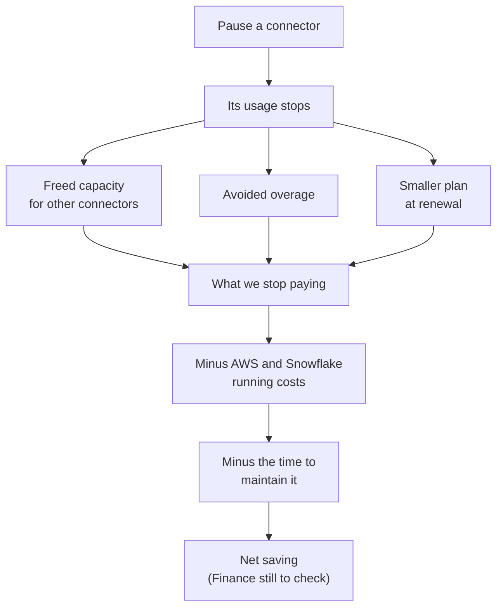

# The One Where You Leave a Managed Connector

Last week on Obi the Explorer, I told you we replaced three Fivetran connectors with pipelines we run ourselves on Airflow, and that a connector quietly does seven jobs on every run. If you missed it, you can [catch up here](https://plurobi.com/blog/2026/10/20/the-one-where-we-replaced-fivetran/). That post ended by teasing this one, so here we are.

The seven jobs were only the start of what we took on. This week is about the rest of the inheritance and why pausing a connector doesn't put any money back in your pocket.

<!-- more -->

## The ask

Every cost-saving project ends up in the same conversation. Someone asks, "So how much have we saved?"

For me, it came in a team chat a couple of weeks after we paused the last connector. A colleague asked for a summary of the work to share with an exec. The message outlined what it should cover: how much I'd cut from Fivetran spend, what MWAA costs given it also runs our ML models, and how much of that was due to AI.

I answered in three short bullets. The first one was the tricky one, because usage and cash are two different measures. We're on a prepaid plan, so I wrote that the immediate benefit was freed capacity. The cash only shows up if we avoid overage or buy less at renewal. So delayed gratification?

A few days later, the exec called it a cool example of using AI to save money, and asked where else we could save more. And that, my dearest gentle reader (permit me to plagiarise Lady Whistledown), is how you get more work for yourself when you do a good job. More connectors are on the list to look at next year.

"How much have we saved?" is a fair question, and it has two answers. How much usage we took off Fivetran, I can tell you. How much cash we've saved, I can't answer properly yet, and the reason is more interesting than the answer would have been.

On paper, the story is simple. We pay Fivetran for usage. We moved three connectors off it. So we should pay less, right? I wish it worked like that, but three things get in the way, and none of them are bugs.

The first is what you inherit when you leave. The second is how a prepaid plan behaves. The third is that the replacement has its own running costs. Let's take them in order.

## What you inherit

Last time, we covered the seven jobs. Here's a bunch of other stuff you have to handle when you (or your team) own the pipeline:

1. **You choose the scope.** A managed connector syncs whatever it's set up to cover. Ours now copy only the tables and fields our consumers actually use.
2. **You hold the state.** Fivetran kept its own record of where it stopped so it would know where to start adding new rows. We now keep a visible one: a ledger, a checkpoint or a watermark, depending on the source. (One whole post is coming on those three.)
3. **You own recovery.** When a managed connector fails, the platform decides how to recover. When ours fails, a retry is safe because the load is **idempotent** (running it twice gives the same result), and a runbook tells whoever is available what to do.
4. **You own change.** When a source changes, the fix is submitted as a pull request. The contracts, tests, and deployment all live in git, within the code-review path, while a settings change in a vendor tool sits outside it.
5. **You pay the running costs.** AWS, Snowflake compute and storage, network and monitoring all send their own bills.
6. **You pay in time.** Someone has to keep it healthy. That someone is us.

Some of that is good news. Owning the pipeline means it runs only the schedule and scope we need, which is where we expect the lower running costs to come from. AWS certainly isn't free, and I'll get to its bill in a moment.

## Why pausing doesn't refund anything

This is the bit that surprised me most when I worked it through. Here's the money, one step at a time:

1. **Usage is a meter reading.** Fivetran's usage report tells you how much of the service you used. Your invoice tells you what you paid. The two move together only if you pay for exactly what you use, i.e., the typical pay-as-you-go model.
2. **Our plan is prepaid.** Think of a prepaid meal plan. You load it once. If you stop eating at the canteen, the balance doesn't shrink, and nobody posts the difference to you. I had one at uni and, honestly, it was a game-changer, but never getting my balance back hurt.
3. **So where does the benefit show up?** In three places. Capacity we free up, which other connectors can use. Overage we avoid, which matters when usage is creeping towards the limit. And a smaller plan, or pay-as-you-go, when the plan comes up for renewal. It also gives you some negotiating power when you are trying to work out a new deal.
4. **Take off what the replacement costs.** What we save is what we stop paying Fivetran, minus what the new setup costs us. That means AWS, Snowflake, and the time it takes to keep the pipelines healthy. It's like cancelling a meal-delivery subscription: you save on the fee, but now you're buying groceries and investing time in meal prep.
5. **Charge all of MWAA to these three pipelines.** We built MWAA to replace three connectors. Since then, colleagues have started running their ML models on it too, which I didn't plan for, but I'm glad it happened. It does mean the bill is shared. When I calculate the savings, I still count the full MWAA bill against these three pipelines, even though the ML models use some of it. That way, if the savings hold up, nobody can say I flattered it.
6. **Keep real months and guesses apart.** A month that has already happened is a fact. A month I haven't lived through yet is a guess, even if I'm confident about it. If I assume a connector's usage stays at zero, that only holds until someone switches it back on.

Notice who's missing from that list: the number. We'll get to that.

*Pausing a connector starts the sum. It doesn't finish it.*

Obviously, as per tradition, I still have to talk about what movie or show this part of the project reminded me of. Today, that's **Freaky Friday**. No spoilers, but a mother (Jamie Lee Curtis) and her daughter (Lindsay Lohan) swap bodies because each thinks the other has it easy.

Then they spend a day living each other's lives and find out how much work was hiding in the parts they never saw. Leaving a managed connector felt a bit like that. We swapped places with the vendor and found out what their day really involves. We never swapped bodies because that would be impossible.

Back to being serious...

## What changed

| | Fivetran connector | Our pipeline |
|---|---|---|
| Scope | Whatever the connector is set up to sync | Only the tables and fields our consumers use |
| State | Kept by Fivetran | A visible ledger, checkpoint or watermark |
| Recovery | The platform decides | Safe to re-run, plus a runbook for the people |
| Change | A setting in a vendor tool | A pull request, with tests, in git |
| Cost | A prepaid plan, drawn down by usage | AWS and Snowflake running costs, plus our time |

Same data, same dashboards. A different owner, and a different bill.

## Three decisions worth arguing about

### Why only the tables and fields we use?

Every table we sync is a table we maintain. So we built the pipelines around what our consumers already read, and nothing more, at least for now.

The trade-off is real because if someone asks for a table we didn't build, that's new work. That's why I wrote a new-ingestion runbook. This way, any other team member has the recipe ready, instead of wasting time on unnecessary research.

### When should you build instead of buy?

My rule comes from the handover deck I made. Use MWAA where custom logic, scheduling, state and recovery justify team ownership. In plain words, ask these questions about each connector:

1. **Does the source need logic a standard connector can't give you?**
2. **Do you need to choose the schedule yourself?**
3. **Do you need to see and control where the pipeline stopped?**
4. **Do you need to control how it recovers?**
5. **Is the saving big enough to cover the extra work?**

If you answer yes to most of them, owning the connector may be worth the effort. If every answer is no, I'd keep paying. A connector that fits and runs quietly is cheaper than it looks. We still run other connectors on Fivetran for now, and some of them are on the list to look at next year. The future is fluid.

### Why won't I give you a number?

I can't back a number yet. Here's what I'd want before publishing one:

1. **Finance checks the sums.** That includes the running costs of the replacement. I'll edit this post or create a new one after I see what was saved.
2. **Complete billing months with all three connectors paused.** Then I'm reading actuals, not forecasts.
3. **The renewal outcome.** That's where the benefit turns into real cash, or doesn't.

I'll come back with it when I have it.

## What's still missing

Here's what I can't tell you yet.

I can't tell you the net savings, and you've just read why.

I can't tell you how much time upkeep will take. It definitely isn't zero, and I haven't measured it. I won't guess at a percentage.

I can't tell you the right answer for your stack. Mine had a prepaid plan, three connectors that made up 96% of our usage, and a team willing to do the extra work. Your situation might look nothing like that.

Next Monday, I'll write about how to prove a migration actually worked because I guarantee you that matching row counts won't be enough.

## Backstage

In Freaky Friday, the swap lasts a day. Ours is permanent, and I now have a lot more respect for the work Fivetran does. It's real value they provide. Honestly, expensive but real. Ask me how the swap is going when the plan comes up for renewal.

What's the first cost you'd check before building your own pipeline?
