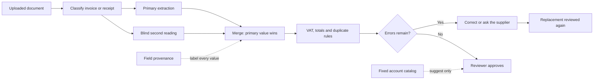

# Invoice Review System

!!! abstract "Case Study Summary"
    **Client context:** Small-business finance and administration  
    **Delivery type:** Hosted product for invoice and receipt review  
    **My role:** AI Engineer  
    **Headline impact:** **Approval blocked until VAT, totals, and duplicates pass**

In a small business, one person still decides whether a supplier invoice can be paid.

I built the review that person can run: two readings of the same document, rules that decide whether approval is allowed, and a correction request that brings the supplier's replacement back through the same check.

## Challenge

Supplier invoices and employee receipts land in one inbox. They arrive as PDFs, scans, and phone photos, often in more than one language. Before anything is paid, someone has to recognise the document, confirm the figures, check VAT, and choose an account.

Handing that whole job to a language model creates a quieter failure:

- a confident extraction can still be a document that should not be approved;
- a model that rewrites an invalid VAT number or a wrong total hides the error;
- a missing purchase order and a duplicate invoice are treated as the same kind of problem;
- the supplier receives a vague request, and the corrected file is reviewed again by hand; and
- the person approving the document cannot see where each figure came from.

## Technical Solution

I separated reading the document from deciding what happens to it.

### 1. Read the file twice, independently

The original PDF or image goes to Azure Document Intelligence and, separately, to a language model that never sees the first result. Classification chooses the invoice extractor or the receipt extractor. Agreement is visible. Disagreement stays on the page.

### 2. Keep the primary value when the readings conflict

Document Intelligence keeps any field it extracted. The model may fill only a blank, and only when the text parses as a date, an amount, or an identifier. An invalid VAT number and a total that does not add up stay wrong, so the rules still have an error to catch. Every field is labelled primary extraction, model fallback, or human edit.

### 3. Decide with finance rules

Invoice policy and receipt policy are ordinary Python, and each document kind has its own rules.

An invoice is blocked by a missing identity, a bad or missing supplier VAT number, a customer VAT number that is not the company's, a total off by more than one cent, or a vendor-and-invoice pair already on file. A missing purchase order and a low-confidence extraction are warnings. They leave the document approvable.

A receipt records money already spent. It needs a merchant, a date, a currency, a positive total, and a VAT amount. VAT structure is checked locally.

### 4. Suggest an account from a fixed catalog

The model proposes one code from ten accounts, using the normalised fields. An unknown code cannot be saved. The suggestion is the default selection. The reviewer can change it, and approval requires an account from the catalog.

### 5. Return supplier errors through the same review

Only blocking errors the supplier can fix become a correction email. A duplicate and a low-confidence reading stay internal. Sending the email marks the document as waiting on the supplier. A signed reply on that thread, carrying one PDF or image, is matched to the thread and processed again. Rejection stays a separate, final decision.

## Results & Impact

- Gives the reviewer a document that is **ready** or **blocked**, with the reason shown beside the approve button.
- Handles invoices and receipts in **English, Dutch, German, and French**, including a photo receipt, a lower-quality scan, and a two-page invoice.
- Checked against **13 documents**: **12 invoices, one fuel receipt, 14 pages**.
- Stops the failures that matter before payment: a missing VAT number, an invalid VAT number, the wrong customer VAT number, a total that does not reconcile, and a duplicate. A missing purchase order warns without blocking.
- Keeps the primary value when the two readings disagree, so a bad VAT number or a bad total cannot be quietly repaired.
- Costs about **$0.03 per document** to run the full review, and about **1 cent** to draft the supplier correction. Checking all 13 documents is about **$0.44**.
- Keeps approval unavailable while an error remains, edits are unsaved, or no account is selected.

!!! note "How the figures are framed"
    The cost figures are rounded planning envelopes from published Azure prices. They are the cost of checking a document, so a small business can run the review on every invoice.

## Solution Architecture

The diagram follows one document from upload to a decision.

## Tech Stack

- Python and FastAPI
- Pydantic
- React and TypeScript
- Azure AI Document Intelligence
- Azure OpenAI
- SQLite
- Nylas
- Offline EU VAT checks
- Azure Container Apps

## Additional Context

- **Period:** July to October 2026
- **Environment:** Hosted product for small-business invoice and receipt review
- **My contribution:** Product design, dual-reading pipeline, merge and provenance, invoice and receipt policy, review interface, supplier correction loop, and deployment
- **Who it's for:** The person in a small business who still decides whether each supplier invoice can be paid

--8<-- "cta-book-call.md"
